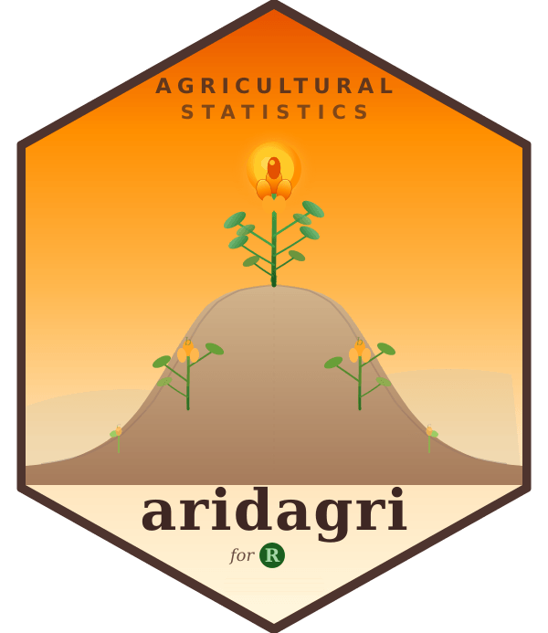

# aridagri 

<!-- badges: start -->
[](https://github.com/lalitrolaniya/aridagri/actions/workflows/R-CMD-check.yaml)
[](https://cran.r-project.org/package=aridagri)
[](https://cran.r-project.org/package=aridagri)
[](https://doi.org/10.1016/j.simpa.2026.100851)
[](https://cran.r-project.org/web/licenses/GPL-3)
<!-- badges: end -->

**aridagri** analyses the field experiments that agronomists and plant
breeders run every season: CRD, RCBD, factorials, the whole split-plot
family, strip plots, combined analysis over years and locations, augmented
and alpha lattice trials, repeated measurements, and stability analysis. Each
analysis gives the correct error term for every source, SEm, SEd, CD and CV,
and letter groupings, in the form journals and theses ask for.

Website: <https://lalitrolaniya.github.io/aridagri/>

## Installation

```r
install.packages("aridagri")

# development version
# install.packages("remotes")
remotes::install_github("lalitrolaniya/aridagri")
```

## A table for your paper in one call

```r
library(aridagri)

tab <- anova_traits(mothbean_rbd,
                    traits = c("plant_height", "pods_per_plant",
                               "seed_yield", "harvest_index"),
                    design = "rbd", treatment = "treatment",
                    block = "block", posthoc = "duncan")
export_results(tab, "Table_2.xlsx")
```

```
 treatment            plant_height pods_per_plant seed_yield harvest_index
 T1 Control           30.25 c      19.05 e        516.25 d   29.77
 T2 RDF               33.33 ab     24.70 cd       604.75 c   30.30
 ...
 T5 RDF+Rhizobium+PSB 35.00 a      29.10 a        705.00 a   32.33
 SEm ±                0.63         0.75           15.60      0.77
 CD (p = 0.05)        1.86         2.21           45.88      NS
 CV (%)               3.77         5.93           4.97       4.91
```

## What it covers

| Area | Functions |
|------|-----------|
| Single-factor designs | `anova_crd()`, `anova_rbd()` (missing plots handled), `anova_latin()` |
| Factorials | `anova_factorial()`, `anova_factorial_3way()` |
| Split-plot family | `anova_spd()`, `anova_spd_ab_main()`, `anova_spd_c_main_ab_sub()`, `anova_spd_ab_cd()`, `anova_sspd()`, `anova_strip()` |
| Over environments | `anova_rbd_pooled()` (fixed or random environments), `anova_spd_pooled()`, `anova_sspd_pooled()` |
| Breeding trials | `anova_augmented()` (adjusted means, genetic parameters), `anova_alpha_lattice()` (REML or intra-block) |
| Repeated measures | `anova_repeated()` (sphericity corrections, CS/AR1/UN models) |
| Mean comparisons | `perform_posthoc()`, `compare_means()`: LSD, DMRT, Tukey, SNK, Scheffe, Bonferroni, Dunnett |
| G x E | `stability_analysis()` (Eberhart-Russell, AMMI, Finlay-Wilkinson, Shukla, Wricke, CV, Lin-Binns), `gge_biplot()` |
| Agronomic indices | `thermal_indices()`, `day_length()`, `crop_growth_analysis()`, `harvest_index()`, `yield_gap_analysis()`, `nue_calculate()`, `nutrient_response()`, `economic_analysis()` |
| Multivariate | `correlation_analysis()`, `pca_analysis()`, `path_analysis()`, `sem_analysis()` |
| Figures and export | `plot()` methods, `plot_means()`, `plot_interaction()`, `plot_stability()`, `plot_response()`, `arid_plot()`, `export_results()` |

## Examples

```r
# Split plot: ANOVA with Error(a) and Error(b), and the four CDs
sp <- anova_spd(clusterbean_spd, "seed_yield", main_plot = "irrigation",
                sub_plot = "nitrogen", replication = "rep")
plot_interaction(sp)

# Stability over six environments
st <- stability_analysis(pearlmillet_met, "genotype", "environment",
                         "rep", "grain_yield")
plot_stability(st, "ammi2")
gge <- gge_biplot(pearlmillet_met, "genotype", "environment", "grain_yield")
plot(gge, type = "which_won_where")

# Germplasm in an augmented design: adjusted means and heritability
au <- anova_augmented(chickpea_augmented, "seed_yield", "entry", "block",
                      check_names = c("C1", "C2", "C3", "C4"))

# Repeated measurements on the same plots or animals
rm <- anova_repeated(mungbean_repeated, "spad", "treatment", "das",
                     block = "block")

# Letters from a published table (means, error MS and df only)
compare_means(c(T1 = 1180, T2 = 1265, T3 = 1342, T4 = 1410),
              mse = 3600, df_error = 12, reps = 4, method = "duncan")
```

## What changed in 2.1.0

Version 2.1.0 corrects several calculations (relative efficiency in RCBD,
the pooled RCBD error terms and silent mode, the strip-plot F-tests, the
split-plot table returned to the user, Shukla's variance, the AMMI
stability value, Eberhart-Russell S2di, the variance test in
`check_assumptions()`, and the utilization efficiency in `nue_calculate()`).
If you used these functions in 2.0.x, please rerun the analyses. See
[NEWS](NEWS.md) for details.

All letter groupings are now computed in the package and agree with
'agricolae' on balanced data; unequal replication and missing plots are
handled exactly. Results are tested against 'agricolae', 'emmeans', `aov()`
error strata and base R's sphericity tests (607 test expectations).

## Citation

```r
citation("aridagri")
```

Rolaniya, L.K., Jat, R.L., Punia, M., Choudhary, R.R. and Poonia, H. (2026).
aridagri: An R package for comprehensive statistical analysis of agricultural
field experiments. *Software Impacts*, 29, 100851.
<https://doi.org/10.1016/j.simpa.2026.100851>

## Authors

| Author | Affiliation |
|--------|-------------|
| **Lalit Kumar Rolaniya** (maintainer) | Scientist (Agronomy), ICAR-Indian Institute of Pulses Research, Regional Centre, Bikaner |
| **Ram Lal Jat** | Senior Scientist (Agronomy), ICAR-Indian Institute of Pulses Research, Regional Centre, Bikaner |
| **Monika Punia** (deceased) | Scientist (Genetics and Plant Breeding), ICAR-Indian Institute of Pulses Research, Regional Centre, Bikaner |
| **Raja Ram Choudhary** | Scientist (Agronomy), ICAR-Indian Institute of Groundnut Research, Regional Research Station, Bikaner |
| **Hemant Poonia** (deceased) | Assistant Professor, Department of Mathematics and Statistics, CCS Haryana Agricultural University, Hisar |

*Version 2.1.0 is dedicated to the memory of our co-authors Dr. Monika Punia
and Dr. Hemant Poonia.*

## License

GPL-3
